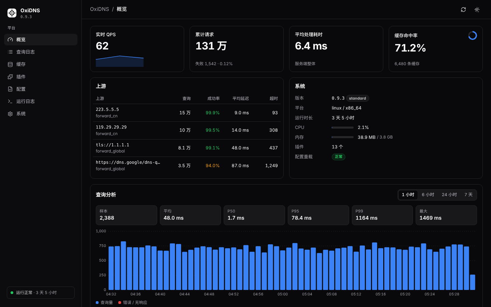
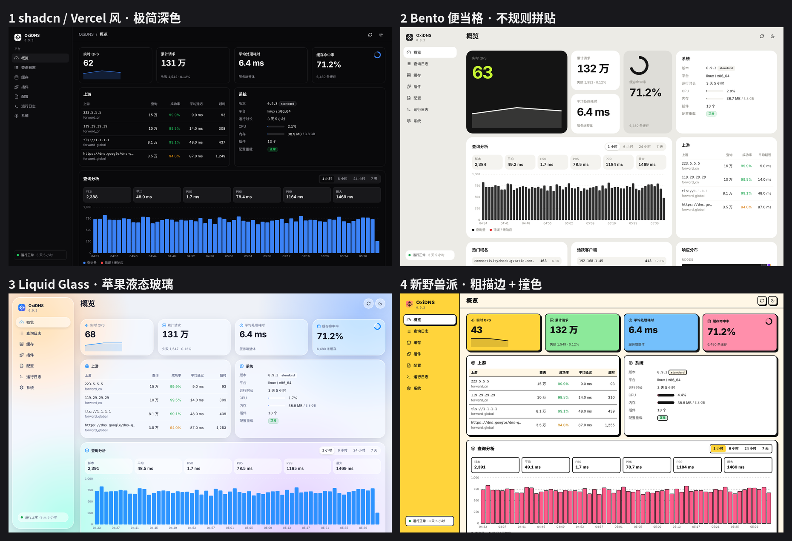
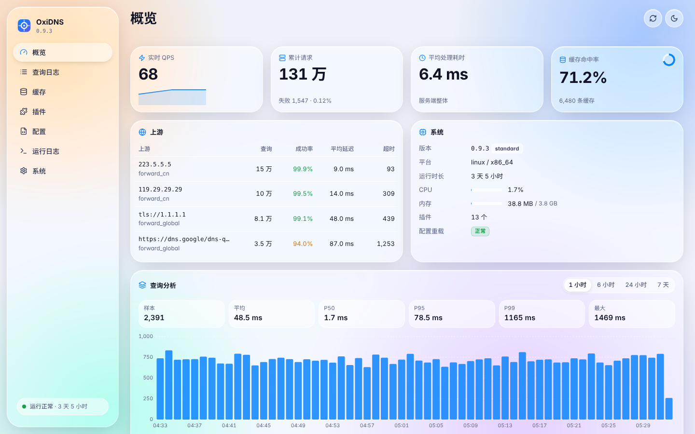
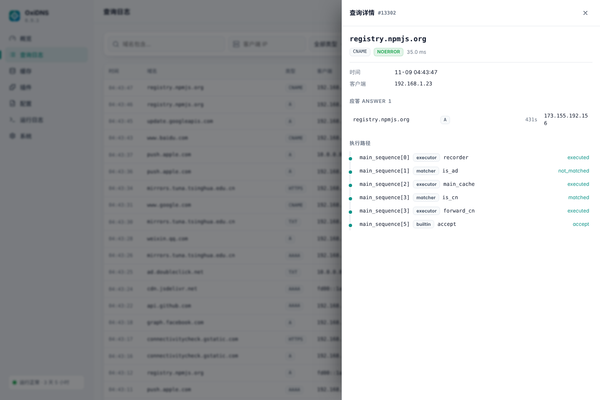

# OxiDNS Dashboard

一个简洁、好看的 [OxiDNS](https://github.com/svenshi/oxidns) 管理面板。完全基于 OxiDNS 现有的管理 HTTP API，**不需要修改后端**。



构建产物只有**一个 `index.html`**（约 160 KB，零外部依赖、不加载任何 CDN），丢到任意静态服务器上即可使用。

## 功能

| 页面 | 内容 |
| --- | --- |
| 概览 | 实时 QPS、累计请求、平均耗时、缓存命中率；上游成功率 / 延迟；CPU / 内存；查询趋势图（1h / 6h / 24h / 7d）、P50/P95/P99、热门域名、活跃客户端、RCODE 与记录类型分布 |
| 查询日志 | 按域名 / 客户端 / 类型 / RCODE / 状态 / 时间筛选，实时刷新，点击查看应答记录和 sequence 执行路径 |
| 缓存 | 命中统计、按域名搜索、查看 / 删除单条、清空缓存 |
| 插件 | 按类型分组的插件卡片与关键指标；匹配器运行时模式（正常 / 恒真 / 恒假）、数据源热重载、cron 任务手动运行、download 下载、动态域名规则增删 |
| 配置 | 带行号和语法高亮的 YAML 编辑器，校验、保存、保存并热重载，错误行定位，并发修改冲突提示，`Ctrl/⌘ + S` |
| 运行日志 | SSE 实时日志流，级别切换、关键词过滤、暂停、自动滚动 |
| 系统 | 版本、平台、构建特性、热重载、重启、在线升级 |

内置 5 种外观风格，可在顶栏调色板按钮或「系统」页随时切换（保存在当前浏览器），每种都有浅色 / 深色 / 跟随系统：

- **极简**（默认）：shadcn / Vercel 风，黑白灰 + 细边框
- **便当格**：Bento 拼贴布局，大号数字与色块
- **液态玻璃**：苹果 Liquid Glass，柔光背景 + 磨砂半透明卡片
- **新野兽派**：粗描边、硬阴影、撞色
- **经典**：青绿色控制台



适配桌面与手机。

| 液态玻璃 · 浅色 | 查询详情 |
| --- | --- |
|  |  |

> 查询日志和概览里的查询分析依赖 `query_recorder` 插件；缓存页依赖 `cache` 插件；指标依赖 `metrics` 构建特性。未启用的部分会自动隐藏或给出提示。

## 获取

- 在 [Releases](../../releases) 下载 `index.html`，或
- 自己构建：

```bash
npm ci
npm run build        # 产物：dist/index.html
```

## 部署

面板默认请求同源的 `/api/*`。推荐让面板和 API 处于**同一个源**，有三种方式：

### 1. 由 OxiDNS 自己托管（最简单）

OxiDNS 的 API 监听支持静态目录，API 路由会自动挂在 `/api/*` 下：

```yaml
api:
  http:
    listen: ":9199"
    webui:
      root: "/opt/oxidns-dashboard"   # 放 index.html 的目录
```

访问 `http://<主机>:9199/` 即可。

### 2. Nginx / Caddy 反向代理

把 `index.html` 放到站点目录，并把 `/api/` 反代到 OxiDNS API。完整示例见 [`deploy/nginx.conf`](deploy/nginx.conf) 和 [`deploy/Caddyfile`](deploy/Caddyfile)。关键点：

```nginx
location /api/ {
    proxy_pass http://127.0.0.1:9199;   # 保留 /api 前缀
    proxy_buffering off;                # 实时日志（SSE）
    proxy_read_timeout 1h;
    proxy_hide_header WWW-Authenticate; # 开了 Basic 认证时，避免浏览器弹原生登录框
}
```

### 3. 跨域直连

在登录页把「API 地址」填成 `http://<主机>:9199/api`。注意：

- OxiDNS 监听 `0.0.0.0` / `:9199` 时会自动允许任意来源；否则需在 `api.http.cors.allowed_origins` 中加上面板所在的源。
- **如果启用了 `api.http.auth`（Basic 认证），浏览器的 CORS 规则不允许跨域携带 `Authorization` 头**（OxiDNS 返回的 `Access-Control-Allow-Headers: *` 不覆盖它），请求会被拦截。这种情况请用方式 1 或 2。

## 认证

启用 `api.http.auth` 后，在登录页填写用户名和密码；可选择在浏览器中记住（保存在 localStorage）。

OxiDNS 的 401 响应带有 `WWW-Authenticate: Basic`，同源访问时浏览器可能弹出自带的登录框。在里面输入凭据也能正常使用；想统一使用面板自己的登录页，就在反代里隐藏这个响应头（见上文）。

## 本地开发

```bash
npm install
OXIDNS_API=http://192.168.1.2:9199 npm run dev   # /api 代理到你的 OxiDNS
```

没有 OxiDNS 实例时可以用内置的 mock：

```bash
npm run build && npm run mock    # http://127.0.0.1:9199
MOCK_AUTH=admin:secret npm run mock   # 模拟 Basic 认证
```

## 技术栈

Vite + 原生 TypeScript，无前端框架；唯一的运行时依赖是用于解析配置的 [js-yaml](https://github.com/nodeca/js-yaml)。通过 `vite-plugin-singlefile` 内联成单文件。

## License

MIT
